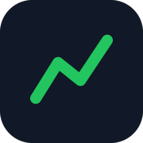
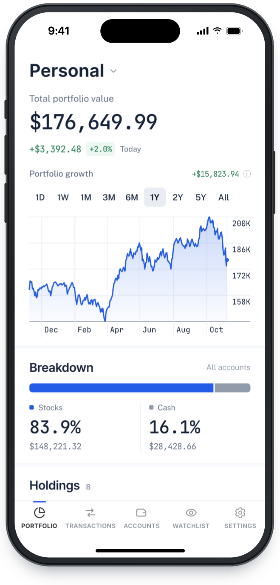
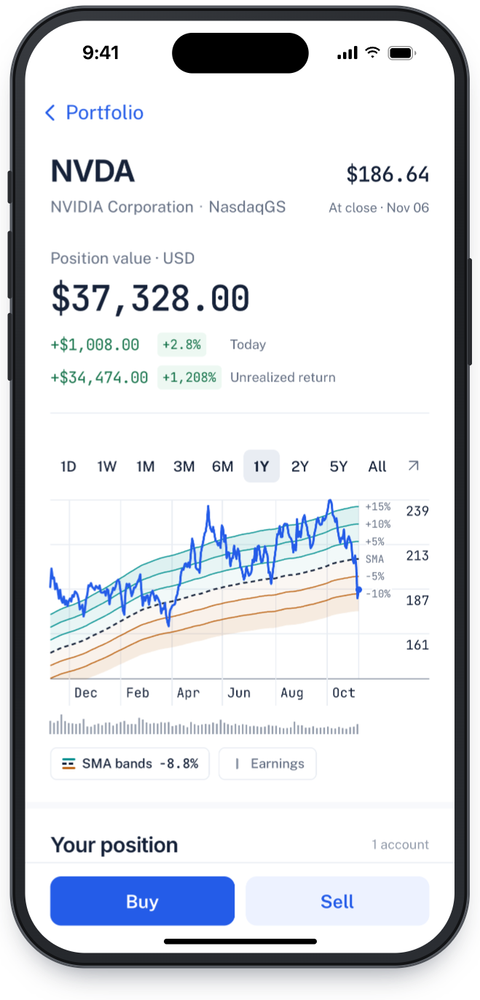
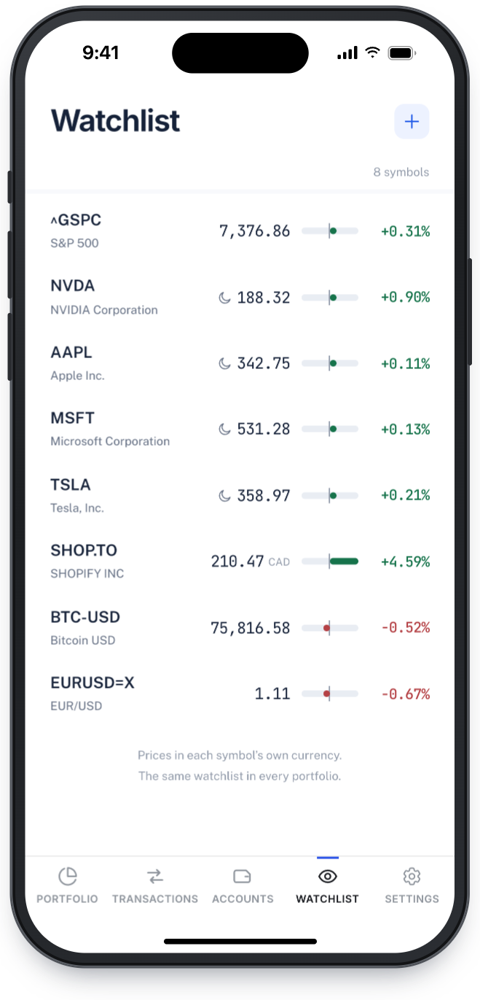
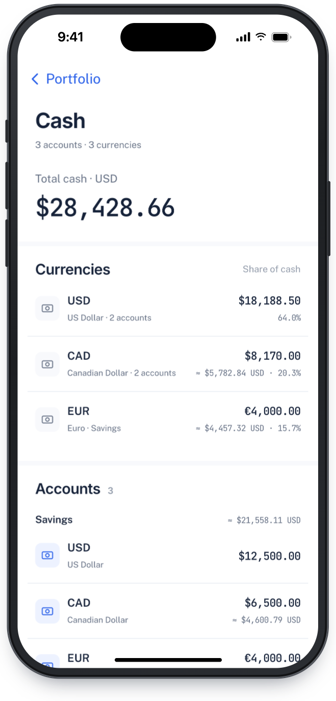
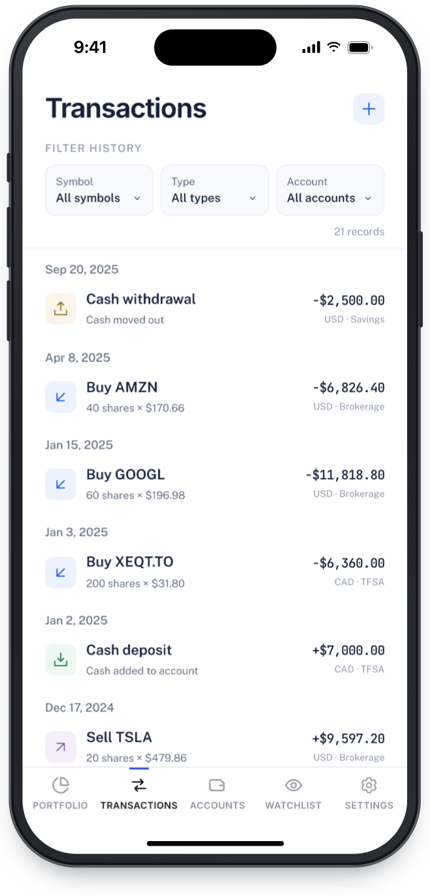

<p align="center"></p>

<h1 align="center">Portifo</h1>

<p align="center">Your whole portfolio, in every currency, on your iPhone.</p>

<p align="center">
  <picture>
    <source media="(prefers-color-scheme: dark)" srcset="docs/screenshots/portfolio-dark.png">
    
  </picture>
  <picture>
    <source media="(prefers-color-scheme: dark)" srcset="docs/screenshots/holding-dark.png">
    
  </picture>
  <picture>
    <source media="(prefers-color-scheme: dark)" srcset="docs/screenshots/watchlist-dark.png">
    
  </picture>
</p>

Portifo keeps track of what you own across all your accounts (brokerage,
retirement, savings) in whatever currency each one holds. Record your buys,
sells, deposits and withdrawals, and it works out the rest: what each holding
is worth today, what you paid for it, what you've made on it, and how the
whole portfolio has grown next to the money you put in. Totals are in US
dollars, and every balance also shows in its own currency.

Prices come from Yahoo Finance and update live while the app is open,
pre-market, after hours and overnight included. Charts run from one day to
all time, with moving-average bands and earnings dates when you want them.
Keep the symbols you don't own on a watchlist, and set a price alert to get a
notification on your phone when one crosses a price.

<p align="center">
  <picture>
    <source media="(prefers-color-scheme: dark)" srcset="docs/screenshots/cash-dark.png">
    
  </picture>
  <picture>
    <source media="(prefers-color-scheme: dark)" srcset="docs/screenshots/transactions-dark.png">
    
  </picture>
</p>

It doesn't connect to your bank or broker, so it works with any account at any
institution, and only what you enter goes in. You can keep several
portfolios, and share one with someone as a viewer, editor or co-owner. It's
free and open source, and you can run your own copy.

## Install

Portifo is a web app that you add to your Home Screen, so there's nothing to
download from the App Store. On your iPhone:

1. Open **[portifo.feghhi.com](https://portifo.feghhi.com)** in Safari.
2. Tap the **Share** icon in Safari's toolbar. On iOS 26, tap **•••** first.
3. Tap **Add to Home Screen** (scroll down, or tap **View More**, if you don't
   see it), then tap **Add**.

Open Portifo from the Home Screen and sign in with Google. It opens full
screen, like any other app. Price alerts need iOS 16.4 or later, and only
reach the Home Screen app, because iOS doesn't send web notifications to
Safari tabs.

<details>
<summary>Android and desktop</summary>

On Android, open the link in Chrome, tap the **⋮** menu, then
**Add to Home screen** (or **Install app**). On a computer, Portifo runs in any
browser at the same address.
</details>

## Run your own

Portifo is a single Node.js process that serves both the app and its API, plus
a Postgres database. Whichever way you run it, you need:

- A [Google OAuth client ID](https://console.cloud.google.com/apis/credentials)
  (Web application type), with your domain added as an authorized JavaScript
  origin.
- VAPID keys for price-alert notifications. Generate a pair with
  `npx web-push generate-vapid-keys`.

### Docker Compose

Brings up the app plus a self-hosted Postgres. Copy `.env.example` to `.env`
and fill in `POSTGRES_PASSWORD`, `GOOGLE_CLIENT_ID`, `SESSION_SECRET` and the
`VAPID_*` keys, then:

```bash
docker compose up -d db
docker compose --profile tools run --rm migrate   # apply Drizzle migrations
docker compose up -d app
```

The app is then served on `http://localhost:${PORT:-3000}`. Compose builds
the image from your checkout, so after a `git pull`, re-run the last two
commands to rebuild, migrate and restart.

### Manual

Build both packages, then run the API in production mode. It serves the built
web app itself:

```bash
pnpm build
NODE_ENV=production pnpm --filter portifo-api start
```

Vite bakes `VITE_GOOGLE_CLIENT_ID` into the web app, so set it when you build.
At runtime, set `DATABASE_URL`, `GOOGLE_CLIENT_ID`, `SESSION_SECRET`, `PORT`
and the `VAPID_*` keys.

## Development

- **`packages/portifo-web`**: Vite + React + [Ionic](https://ionicframework.com/) SPA, rendered in forced iOS mode for a native feel on any device
- **`packages/portifo-api`**: Node/Express backend on [`simple-wire`](https://www.npmjs.com/package/simple-wire), Postgres via Drizzle ORM, background jobs on BullMQ's Postgres backend
- Auth via Google OAuth. Market data via [`yahoo-finance2`](https://www.npmjs.com/package/yahoo-finance2), no API key required.
- Live prices: the API holds one connection to Yahoo's streamer (`wss://streamer.finance.yahoo.com`), polls Yahoo's quotes every 30s alongside it for what the stream leaves quiet, and pushes each quote as it moves to the open app over server-sent events (`GET /market/stream`). The same feed checks price alerts within seconds of a trade. Behind a reverse proxy, `/market/stream` must not be buffered (nginx honours the `X-Accel-Buffering: no` it sends).
- `design-system/` is the app's design system. Open `design-system/index.html` for the gallery.

### Prerequisites

- Node.js 20+
- [pnpm](https://pnpm.io/) `10.20.0` (`corepack enable` will pick this up from `packageManager` in `package.json`)
- A Postgres database
- A Google OAuth client ID, with `http://localhost:5173` as an authorized JavaScript origin, and VAPID keys (see [Run your own](#run-your-own))

### Setup

```bash
pnpm install

cp packages/portifo-api/.env.example packages/portifo-api/.env
cp packages/portifo-web/.env.example packages/portifo-web/.env
```

Fill in the copied `.env` files:

| File | Variable | Notes |
|---|---|---|
| `packages/portifo-api/.env` | `DATABASE_URL` | Postgres connection string |
| | `GOOGLE_CLIENT_ID` | Your Google OAuth client ID |
| | `SESSION_SECRET` | Any long random string (signs the session cookie) |
| | `VAPID_PUBLIC_KEY`, `VAPID_PRIVATE_KEY` | From `npx web-push generate-vapid-keys` |
| | `VAPID_CONTACT_EMAIL` | An email address push services can reach you at |
| `packages/portifo-web/.env` | `VITE_API_URL` | Defaults to `http://localhost:3000` |
| | `VITE_GOOGLE_CLIENT_ID` | Same Google OAuth client ID as above |

Create the database and run migrations:

```bash
pnpm --filter portifo-api db:create        # createdb from DATABASE_URL
pnpm --filter portifo-api db:migrate       # apply Drizzle migrations, then BullMQ's schema
```

Optionally seed some sample data. Copy `packages/portifo-api/src/scripts/seed.data.example.json` to `seed.data.json` next to it (git-ignored), fill in your own accounts and transactions, then run:

```bash
pnpm --filter portifo-api seed
```

### Running

```bash
pnpm dev         # runs both packages in parallel: web on :5173, api on :3000
```

Other useful commands, run from the repo root:

```bash
pnpm build       # builds both packages
pnpm typecheck   # tsc --noEmit in both packages
pnpm lint        # oxlint (web only currently)
```

Per-package equivalents (or scope any command with pnpm's `--filter`):

```bash
pnpm --filter portifo-api dev              # tsx watch src/index.ts
pnpm --filter portifo-api db:studio        # drizzle-kit studio

pnpm --filter portifo-web dev              # vite
pnpm --filter portifo-web preview          # vite preview
```

### Continuous deployment

On every push, `.github/workflows/ci.yml` runs typecheck, lint and build. On pushes to `main`, `.github/workflows/deploy.yml` publishes a release that the production server pulls, triggered by GitHub's release webhook. GitHub holds no credentials for the server. See [`deploy/README.md`](deploy/README.md).

## License

[MIT](LICENSE)
